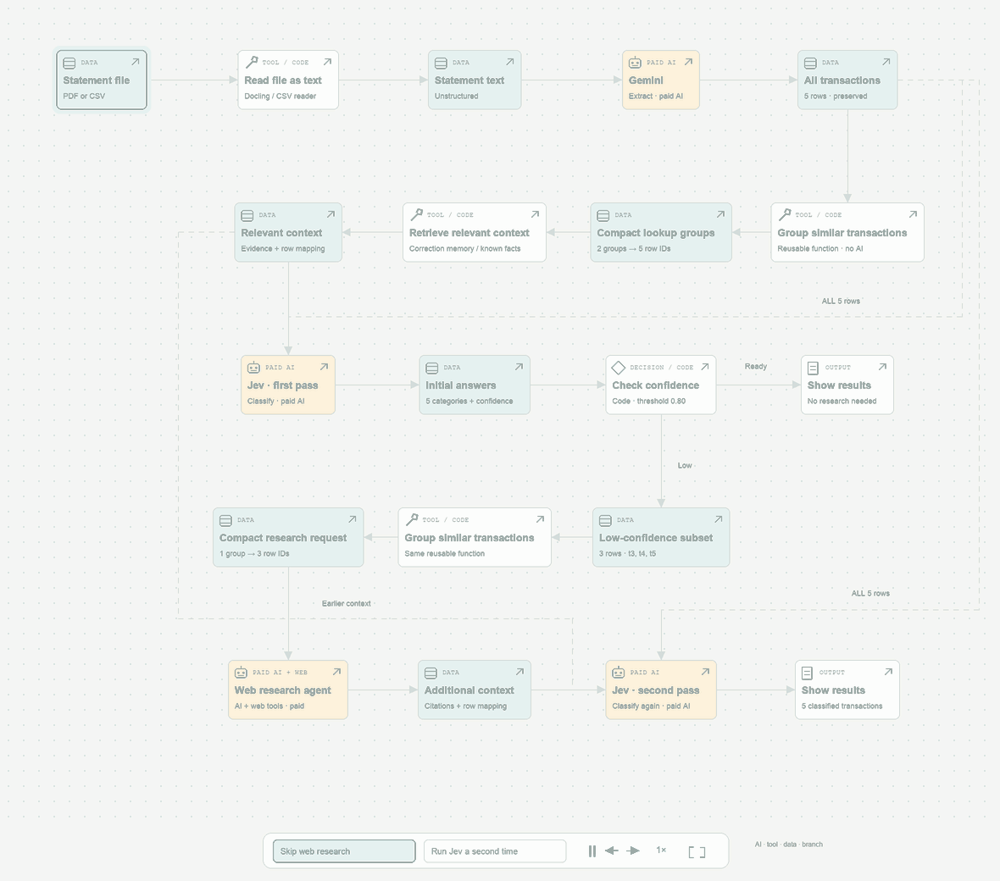
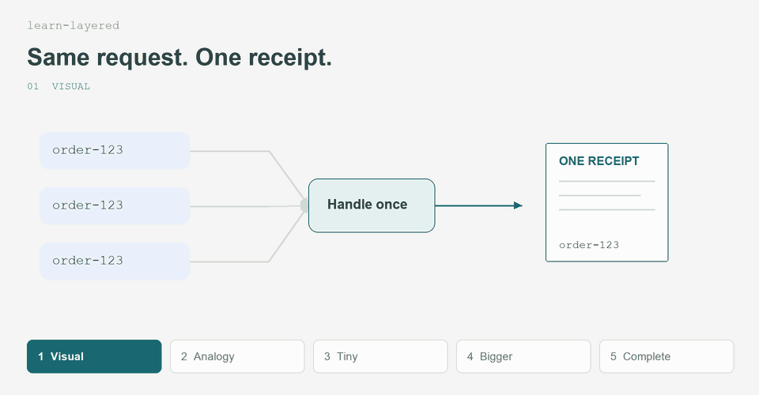

# gabrr-skills

Two skills. See the result, then try a prompt.

## acetate-flow

Interactive workflows from JSON. Expand any step; play either branch.



```text
$acetate-flow Show checkout from order to fulfillment,
with a branch for declined payment.
```

[Example HTML](examples/order-checkout.html) · [Edit its JSON](examples/order-checkout.flow.json) · [Skill](skills/acetate-flow/SKILL.md)

## learn-layered

Visual → analogy → tiny example → bigger example → complete example.



```text
$learn-layered Help me understand idempotency.
```

```text
$learn-layered Explain OAuth, identity, and sessions together.
Use interactive HTML.
```

[Worked example](examples/idempotency.md) · [Runnable code](examples/idempotency.py) · [Skill](skills/learn-layered/SKILL.md)

Images preferred; flows or text when simpler. HTML for connected systems.

<details>
<summary>Install in Codex</summary>

Ask Codex:

```text
Use $skill-installer to install both:
https://github.com/gabrr/gabrr-skills/tree/main/skills/acetate-flow
https://github.com/gabrr/gabrr-skills/tree/main/skills/learn-layered
```

Or copy whole skill folders into `.agents/skills/`.

</details>

<details>
<summary>Generate the example locally</summary>

Python 3; no server or runtime dependencies:

```sh
python3 skills/acetate-flow/scripts/create_flow.py /tmp/checkout.html \
  --config examples/order-checkout.flow.json
```

Open the output in your browser. Add `--force` to replace an existing output.

[JSON format](skills/acetate-flow/references/json-format.md). GIFs are illustrated previews, not screen recordings. Regenerate with `python3 scripts/render-previews.py` (requires Pillow).

All examples use fictional data and make no real payments or AI calls.

</details>

[MIT license](LICENSE)
