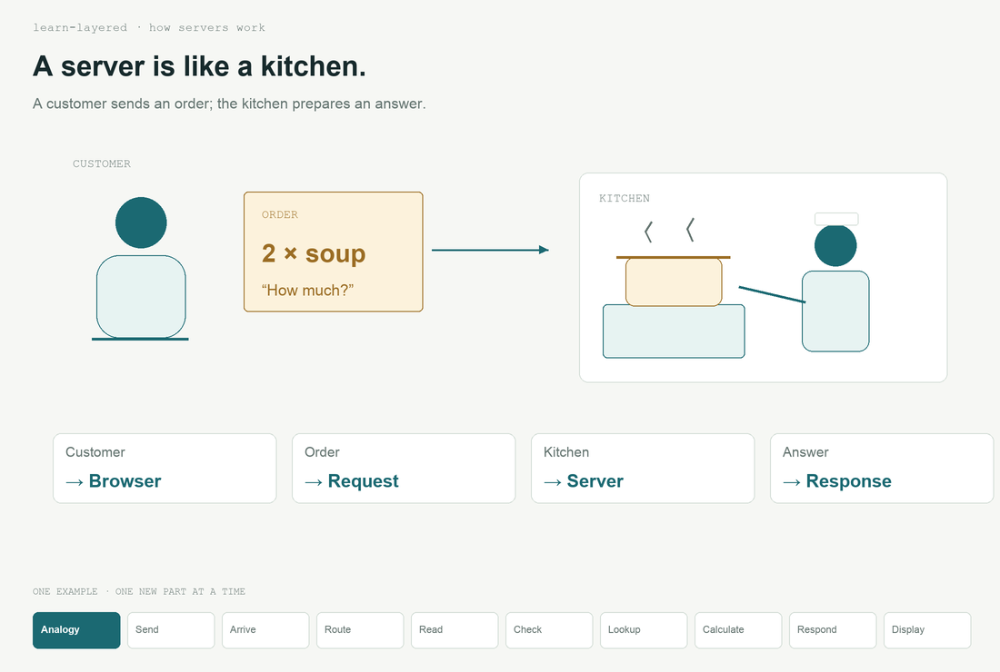
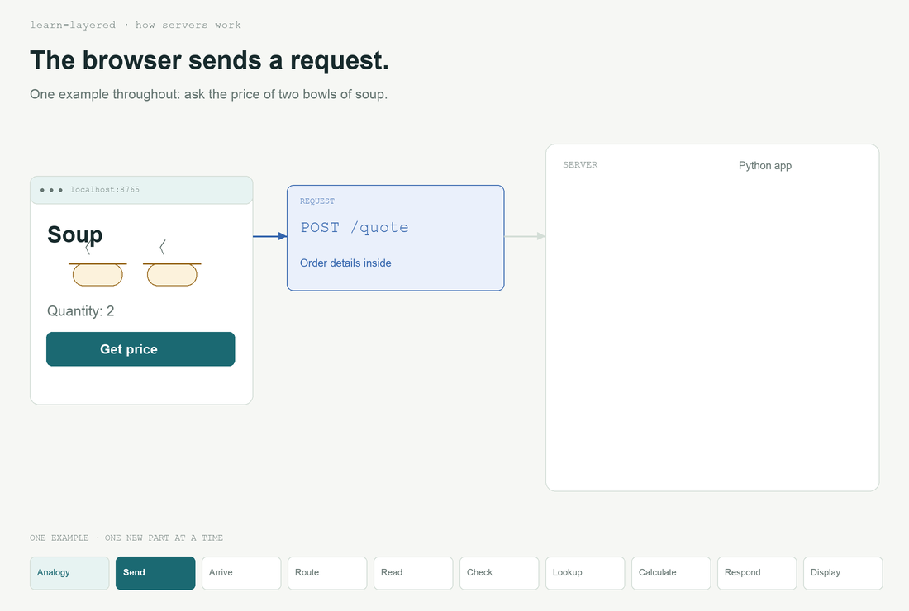
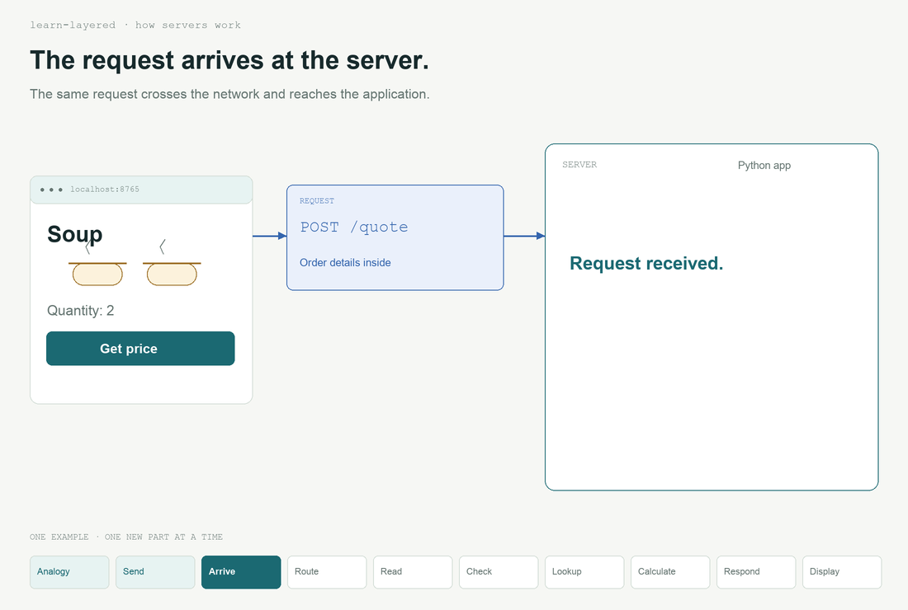
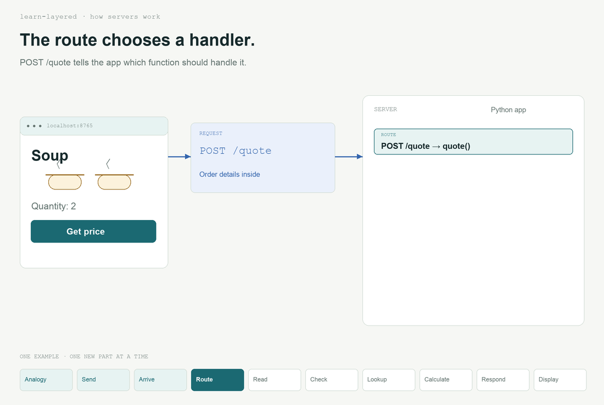
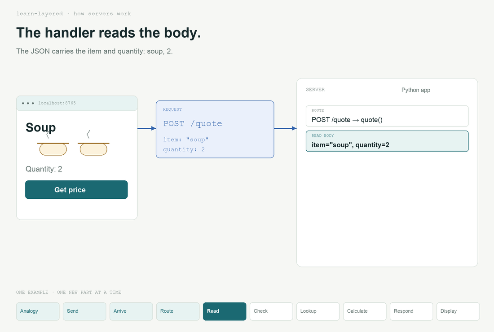
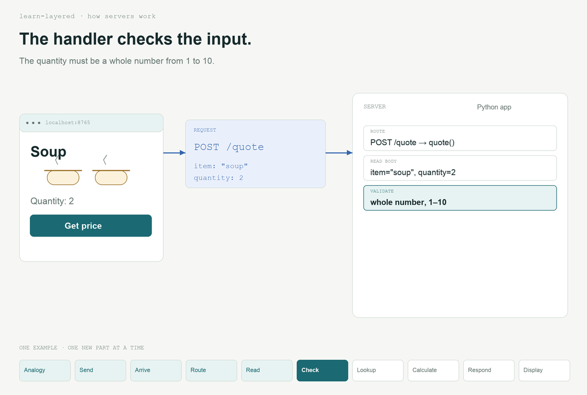
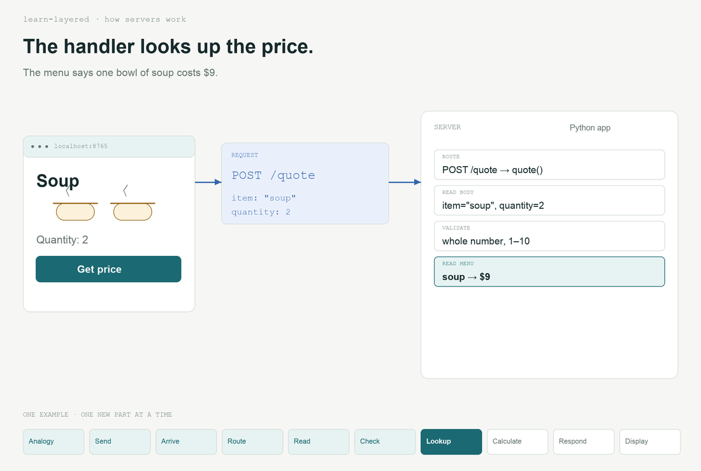
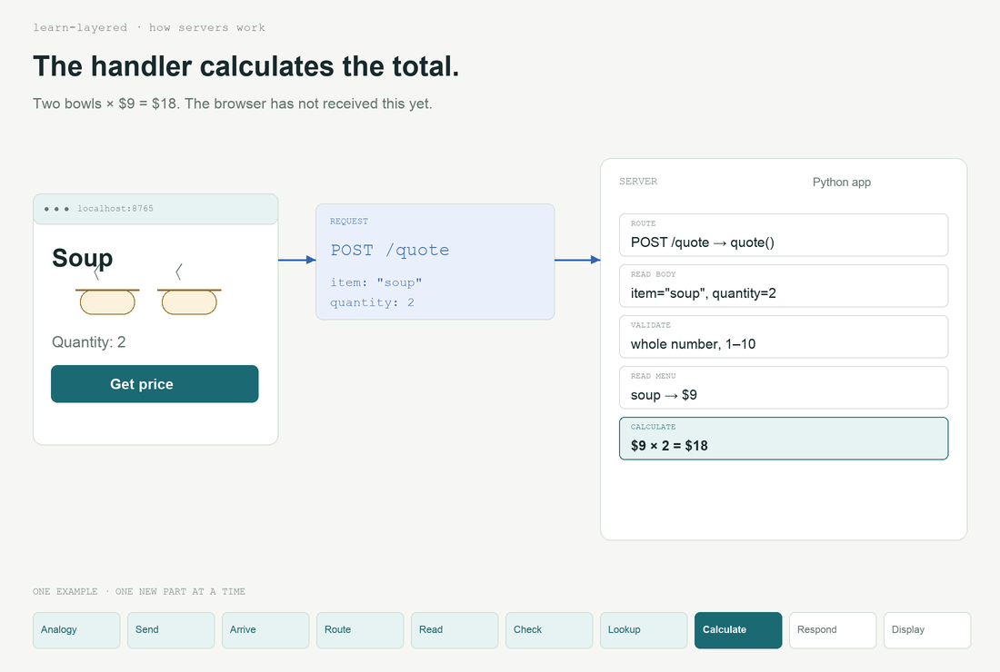
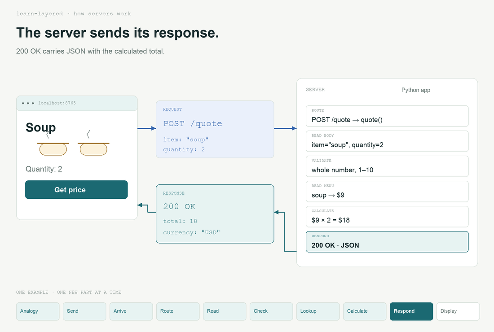
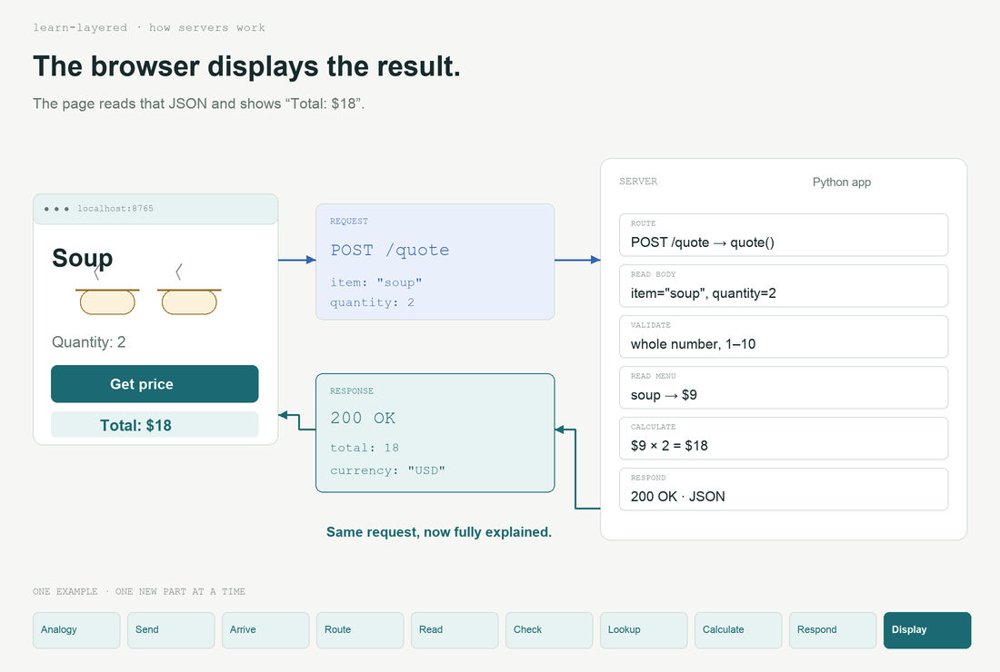

# How servers work

One request throughout: **two bowls of soup → $18**.

[Run the full example](how-servers-work.py) · Python 3, no dependencies.

## 1. A server is like a kitchen



## 2. The browser sends a request



## 3. The request arrives



## 4. The route chooses a handler



## 5. Read the request body



## 6. Check the input



## 7. Look up the price



## 8. Calculate the total



## 9. Send the response



## 10. Display the result



## Try the complete example

```sh
python3 examples/how-servers-work.py
```

Open **http://127.0.0.1:8765** and select **Get price**. Stop with Ctrl+C.

<details>
<summary>See the request and response</summary>

```http
POST /quote
Content-Type: application/json

{"item":"soup","quantity":2}
```

```json
{"item":"soup","quantity":2,"total":18,"currency":"USD"}
```

The server routes, parses, validates, reads its in-memory menu, calculates, then responds. The browser renders the result. This example adds as many layers as these mechanisms require; other topics need different counts.

This is a local teaching server using Python’s standard library, not a production deployment.
</details>
